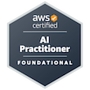

# Alexandre Rothier

Software Engineer | Generative AI, Backend & Cloud

---

I build AI-enabled, cloud-hosted applications using Python, TypeScript, and AWS. My work spans Generative AI and agentic workflows on Amazon Bedrock, backend development, and cloud infrastructure, having progressed from data and analytics into Python systems, cloud engineering, and GenAI.

## What I work with

Python • TypeScript • SQL • AWS Bedrock • Strands Agents • AI Agents • Node.js • Amazon EKS • Terraform

---

📫 [LinkedIn](https://linkedin.com/in/rothier) • alexandrerothier@gmail.com
